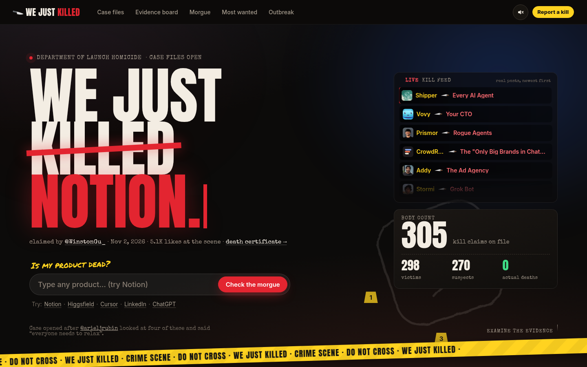
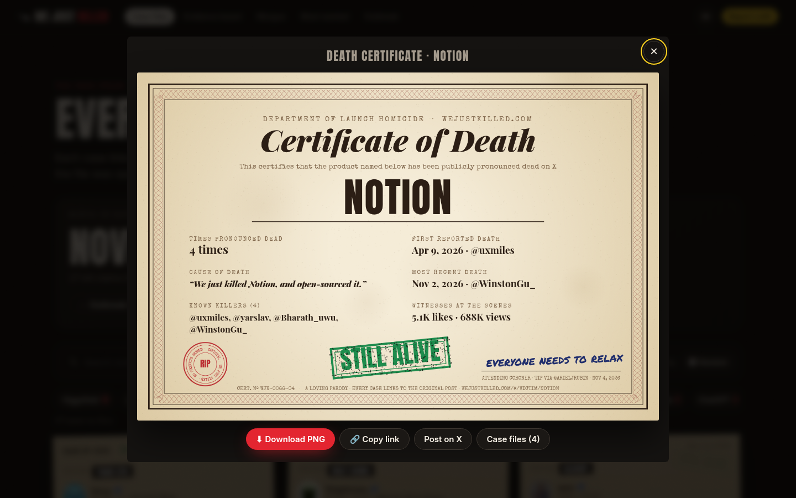

# We Just Killed

A parody "case file" of startup launch posts on X that claim to have "just killed" another product.
305 cases from January 2023 to November 2026, each with a victim, a killer, the evidence post and a printable death certificate.
The original tip came from [@arieljrubin](https://x.com/arieljrubin/status/2117698113217741099).



## Layout

| Path       | What it is                                                                                                                                           |
| ---------- | ---------------------------------------------------------------------------------------------------------------------------------------------------- |
| `site/`    | The deploy root. Static HTML/CSS/JS, no build step. `kills.json` is loaded at runtime; `data.js` is the same data as `window.WJK` for `file://` use. |
| `data/`    | Canonical data (`kills.json`), cases removed during verification (`removed.json`) and curation notes.                                                |
| `docs/`    | Handoff exports (`WeJustKilled_all_kills.md` / `.csv`), the security review and README images.                                                       |
| `scripts/` | Python data scripts (`build.py`, `export.py`, `pool.py`, `verify/`) and Node dev scripts (`serve.mjs`, `csp-check.mjs`).                             |

Routes: `#/`, `#/cases`, `#/victim/<slug>`, `#/killer/<handle>`, `#/month/YYYY-MM`, `#/board`, `#/morgue`, `#/wanted`,
`#/timeline`, `#/report`, plus the modals `#/case/<id>`, `#/cert/<slug>` (death certificate PNG) and `#/verdict/<query>`.

## Run locally

```sh
npm ci                 # dev tooling only; the site itself has no runtime dependencies
npm run serve          # http://127.0.0.1:8780 with the same security headers as vercel.json (PORT=... to change)
```

`python3 -m http.server -d site` also works, but without the production headers.

## Lint, format, test

```sh
npm run lint           # ESLint (+ security, no-unsanitized), Stylelint, HTMLHint, ruff
npm run format         # Prettier, stylelint --fix, ruff format
npm run format:check
npm run test:csp       # headless Chrome renders 15 routes under the production CSP and runs XSS probes
npm run check          # all of the above
npm run audit          # npm audit --audit-level=moderate
```

`test:csp` uses the system Chrome (`/usr/bin/google-chrome`, or set `CHROME_PATH`). Pass `-- --shots DIR` to save screenshots.

## Pre-commit hooks

```sh
npm ci
python3 -m pip install pre-commit
pre-commit install
pre-commit run --all-files
```

Hooks (remote revs pinned to commit SHAs): trailing whitespace, end-of-file, check-json, check-yaml, check-added-large-files
(1 MB), detect-private-key, merge-conflict, LF line endings, gitleaks, ruff check + ruff format, and local ESLint, Prettier
`--check`, Stylelint and HTMLHint using the versions locked in `package-lock.json`. Do not bypass them with `--no-verify`.

## CI and security automation

- **CI** (`.github/workflows/ci.yml`, every push and PR): `npm ci`, lint, Prettier check, CSP render test, all pre-commit hooks, gitleaks over full history.
- **Security** (`security.yml`, daily at 11:00 UTC = 6:00 AM EST / 7:00 AM EDT, on push and on demand): `npm audit --audit-level=moderate`,
  `npm audit signatures`, OSV-Scanner (npm, pip and Actions), gitleaks. A failed scheduled run opens (or comments on) a "Daily security scan failed" issue.
- **CodeQL** (`codeql.yml`, same schedule plus push/PR): JavaScript `security-extended` queries. On a private repo without
  GitHub Code Security the upload step is allowed to fail; the SARIF is kept as a run artifact and error-level findings fail the job.
- **Dependabot** (`.github/dependabot.yml`): daily version checks for npm, GitHub Actions and pip, plus security updates.

All actions are pinned to full commit SHAs with the version in a comment, and every workflow uses read-only `contents` permissions by default.

## Deploying (Vercel)

`vercel.json` serves `site/` as a static site with no build and sets a strict CSP (no `unsafe-inline` or `unsafe-eval`),
`X-Frame-Options: DENY` / `frame-ancestors 'none'`, `X-Content-Type-Options`, `Referrer-Policy`, `Permissions-Policy`,
HSTS and COOP/CORP. Import the repo in Vercel and keep the defaults. After a custom domain is attached and HTTPS is confirmed,
consider adding `preload` to HSTS.

## Data

`data/kills.json` is the canonical dataset; `site/kills.json` and `site/data.js` are copies of it. Each case comes from
public posts found with the X API v2 full-archive search and was checked against the post, its replies and the author's
follow-ups (see `meta.verification`). Only public post fields are stored. Avatars and media are hotlinked from `pbs.twimg.com`.
To regenerate the handoff exports: `python3 -m pip install -r requirements.txt && python3 scripts/export.py`.



## Security

See [SECURITY.md](SECURITY.md) and the [security review](docs/security-review.md).

## License

Code: [MIT](LICENSE). Fonts are self-hosted under the SIL OFL 1.1 and Apache 2.0 (see `site/assets/fonts/LICENSES.md`).
Quoted posts, names, handles and avatars belong to their authors.
